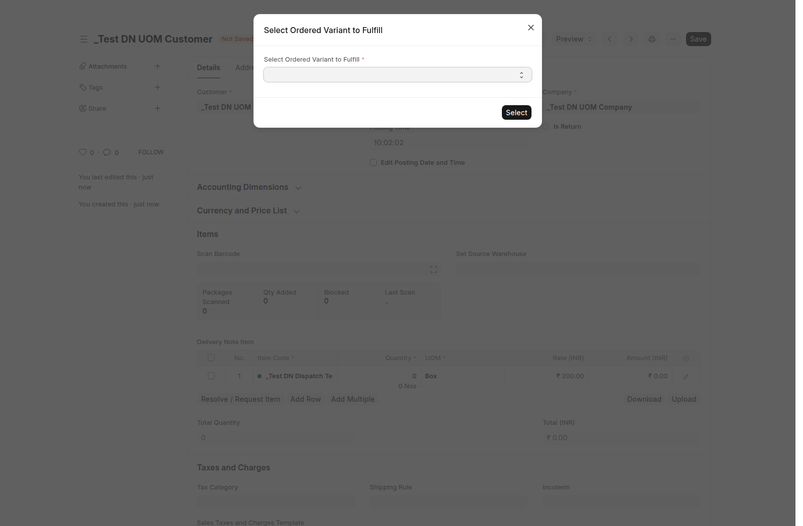
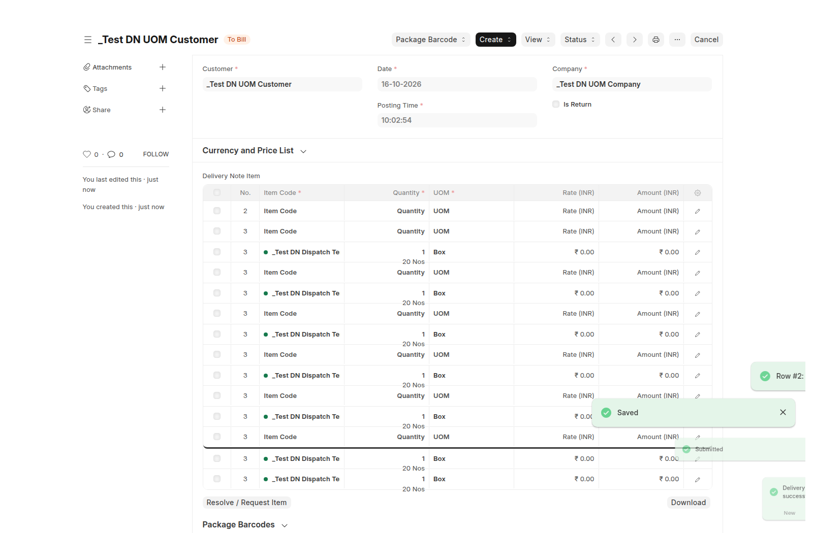

# Delivery Note: whole UOM rows and sibling variant fulfillment

This implements the revised requirements approved on 2026-10-16. It supersedes
the earlier fractional-package entry and mixed-UOM merge behavior recorded in
`delivery-note-uom-validation.md` (PRs #90 and #91, now merged).

## Behavior

- Non-return Delivery Notes store whole quantities in each row's UOM. Fractional quantities are rejected on the server, including direct API writes. The grid displays `2`, rather than `2.0`. Existing return behavior is preserved.
- A scan only increments a row with the same actual item, UOM, selected SO line and compatible warehouse/batch. `BOX` and `PCS` scans create separate rows; repeated scans of one UOM increment that row. The old quantity-entry button that converted pieces into fractional boxes has been removed.
- Each row retains its item-specific conversion factor and stock quantity. An SO ordered in boxes can therefore be fulfilled by whole box/piece rows: at 20 pieces per box, `9 BOX + 3 PCS` records `183 PCS`, equivalent to `9.15 BOX` against the order.
- Force Barcode Only validates scanned quantities per actual item and UOM. Twenty PCS scans cannot be recorded as one BOX, even when their stock quantities match. Where several SO lines share an item/UOM, the existing allocation is kept and the server checks the combined count.
- Eligible substitutions are variants sharing the same nonempty `variant_of` template and stock/base UOM. Names, item groups or similar descriptions do not qualify an unrelated item.
- For an initial substitute scan, the dispatcher must select the ordered line being fulfilled, even if there is only one candidate. Choices show the SO, line number, ordered variant and pending stock quantity. When several eligible lines exist, exact matches appear first without hiding sibling lines. Cancellation of the dialog consumes no scan and creates no row. Later scans can retain an already selected fulfillment link.
- The DN stores the actual dispatched variant while `against_sales_order`/`so_detail` reference the original ordered line. The SO's ordered item is unchanged. Stock moves for the dispatched variant; the SO's delivered/pending quantities use the sum of converted stock quantities. A substitute's own package factor is used, even if it differs from the ordered variant's package factor.
- Link validation checks SO parent/line, customer, company, submitted/open state, template and stock UOM independently of the optional aggregate over-delivery hook. Production's newer `5b45170` change disabling that hook is preserved; dev keeps its existing hook. Other native over-delivery settings are unchanged.
- Invoices mapped from a substituted DN retain the actual variant and original fulfillment link. They cannot be reassigned to another SO line or use the substitution exception for an unrelated direct stock invoice. Existing pricing/rate policies still apply; order items and rates are not rewritten to disguise a substitution.

## Validation and evidence

Tests use independent disposable sites under
`/home/bhickta/development/dn-test-bench`, local MariaDB port `3311`, and the
candidate worktree on `PYTHONPATH`. Shared development and production sites are
not migrated or deployed. No fields or schema migrations are required.

The bench's `run-check.py` invokes Frappe's bench helper from its sites directory.
Executed commands (production site `dn-uom-test.localhost`; dev uses
`dn-uom-dev-test.localhost`):

```sh
<bench-python> run-check.py --site <site> run-tests --app srv_erp --module srv_erp.tests.test_delivery_note_uom_conversion --skip-test-records
<bench-python> run-check.py --site <site> run-tests --app srv_erp --module srv_erp.tests.test_package_barcode --skip-test-records
<bench-python> run-check.py --site <site> run-tests --app srv_erp --module srv_erp.tests.test_delivery_note_sales_order_reference --skip-test-records
node --test srv_erp/tests/js/test_delivery_note_scanner.cjs
<bench-python> run-check.py build --app srv_erp
```

Production results:

```text
Delivery Note UOM/substitution integration: Ran 32 tests in 81.618s / OK
Barcode regression: Ran 16 tests in 1.665s / OK
Sales Order reference regression: Ran 9 tests in 0.059s / OK
Node scanner/display tests: tests 26 / pass 26 / fail 0
```

The integration suite covers actual stock movement and cancellation, original
plus substitute rows, distinct package factors, invoice linkage and cancellation,
foreign templates/items, incompatible stock UOMs, normal-user submission,
permission checks, fractional rejection, zero rows and converted SO totals.
The inventory test checks movement relative to its starting balance so existing
synthetic stock does not make it depend on an empty warehouse.

A Playwright browser check on the production candidate used normal Frappe field
handlers, barcode RPCs, the actual selection dialog and save/submit flow. It
selected the ordered Red variant and dispatched the sibling Blue variant as
`2 Nos` and `1 Box`. The submitted DN contained two whole-UOM rows. The SO's
ordered variant stayed Red and its delivered quantity became `1.1 Box` / `22 Nos`.
A follow-up database check confirmed Blue stock fell from 100 to 78 while Red
stock stayed at 0. Cancellation restored delivered quantity to 0 and Blue stock
to 100. All documents were synthetic records in the disposable site.




The local browser run also encountered existing production grid-extension
startup console errors and unavailable socket.io polling on the isolated server.
They did not block the verified scanner, selection, save or submit flow. Grid
extensions and realtime configuration are outside this change. The build emits
the existing Node `url.parse` deprecation warning.

Final production build: `DONE Total Build Time: 163.036ms`, `Done in 1.06s.`,
`Compiling translations for srv_erp`. Targeted Ruff checks, changed-JS syntax
checks, and `git diff --check` passed. The inventory test was rechecked after
its starting-balance assertion was made independent of seeded stock:
`Ran 1 test in 4.187s / OK`.
